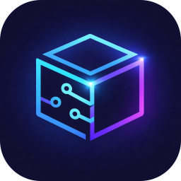
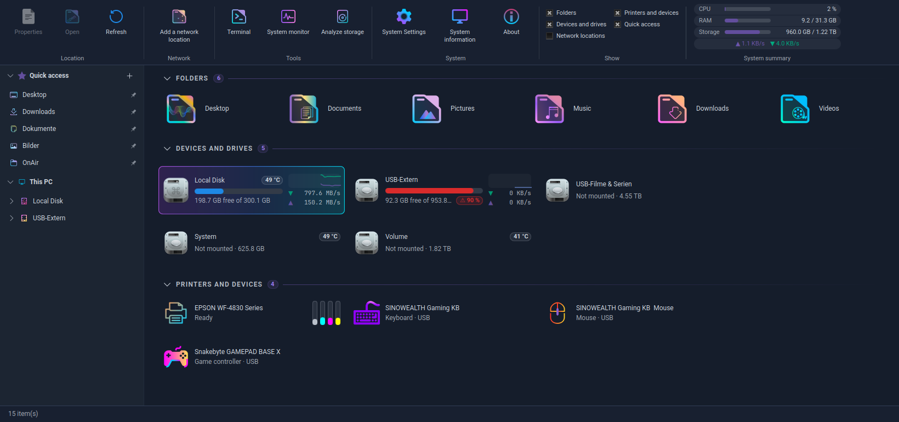
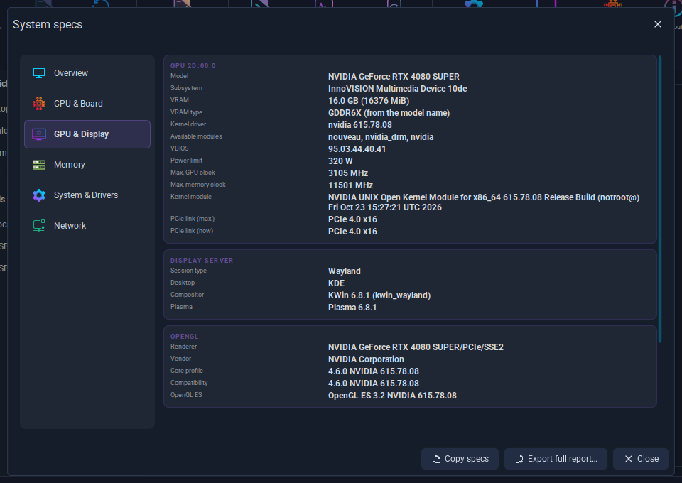

<p align="center"></p>

# DriveDeck

A "This PC" window for **KDE Plasma 6**, inspired by Windows. It shows your personal folders, drives, network
locations, printers and devices in one clean window, and it follows your Plasma colours and icon theme.

> **DriveDeck is a community fork** of **Fenestra "This PC"** by [naykkalak](https://github.com/naykkalak/fenestra-ce-pc).
> All credit for the original idea, design and code goes to **naykkalak**. This fork fixes bugs, makes the program
> faster and adds many new features under its own name. See [what is different](#whats-different-in-this-fork) below, or
> the detailed [CHANGELOG](CHANGELOG.md).

<p align="center"></p>

**Version 2.0.0-beta.1** – feedback and bug reports are very welcome.

---

## What the program does

Open it and you see everything about your computer in one place:

- **Folders** – Desktop, Documents, Pictures, Music, Downloads, Videos. One click opens them in Dolphin.
- **Drives** – internal disks, USB sticks, memory cards and CD/DVD drives, each with a bar that shows how full
  they are. You can eject USB sticks safely, rename them and check the disk health.
- **Network locations** – add a shared folder from another computer or NAS (SMB) without a terminal. Passwords are
  stored safely in KWallet.
- **Printers and devices** – printers with their status and ink levels, plus keyboards, mice, game controllers and
  similar devices.

The window remembers its size, supports 13 languages and uses your own system colours and icons. Drives also show a
small **live graph** of their read and write speed, and warn you when they are almost full.

---

## What's different in this fork

Everything below is explained in plain words. You do **not** need to be a programmer to read it.

### Problems that are fixed

| What went wrong before | What happens now |
|---|---|
| On computers with a **Btrfs** disk, double-clicking your main drive ("Local Disk") opened a strange system folder (`/var/tmp`). | It opens **your home folder**, for every user. The main drive is also recognised correctly again (sort order, icon, health check). |
| The list of drives **flickered** and an open right-click menu **closed by itself** every few seconds, because the free space changes all the time. | The list only redraws when something you can actually see has changed. |
| Network folders with a **space in their name** (for example `My Share`) showed up twice. | They show up once. |
| Version comparison fixed: 1.1.0 was wrongly treated as newer than 1.1, which could trigger a false update notice. | Fixed. |
| A USB stick could be **mistaken for the previous stick** after you swapped them. | Every refresh now checks the real device. |
| A drive that simply had no name could end up with the wrong name, or a drive really named "Local Disk" got renamed. | Unnamed drives get a clear fallback name ("Local Disk" or "Removable Disk"), and real names are left alone. |
| Two parts of the program could **write to the same settings file at the same moment** and corrupt it. | They now take turns. |
| User names containing a `%` sign could break the network login. | They are now rejected with a clear message. |
| Opening folders left **invisible leftover processes** running in the background until the program was closed. | They are cleaned up automatically. |
| If the scanner tool was not installed, the program kept **searching for scanners** for nothing. | It stops when the tool is missing. |

### It is much faster and smoother

- **The window opens instantly.** Slow checks (disks, disk health, network, printers) now run **in the background**
  instead of making the window wait for them.
- **Your drives show up immediately** when you start the program, because the last known list is remembered.
- **One slow device no longer slows down everything.** A switched-off NAS used to delay the printer list. Disks,
  network locations and printers are now handled separately, and many devices are checked **at the same time**
  instead of one after another.
- **Much less work in the background.** The program used to run several system tools every 3 seconds. Now it only
  takes a tiny look at the system every second and does the full check **when something really changes** (you plug in
  a stick, mount a drive, …). Free-space bars are refreshed every 10 seconds.
- **Fewer system calls.** Information that used to need one request per disk is now collected in a single request.

### New features

- **Unmounted drives are now visible.** A second hard disk, a Windows partition or a USB stick that was not opened
  automatically shows up as a card marked "Not mounted". **Double-click it** (or right-click → *Mount*) and it is
  connected and opened. Tiny system partitions (boot, recovery, swap, encrypted) are hidden on purpose.
- **More right-click options**
  - On drives: *Mount*, *Unmount*, *Open in terminal*, *Analyze storage*, *Copy path* (folder cards and the Quick access pane
    also offer *Analyze storage*)
  - On network locations: *Disconnect*, *Open in terminal*, *Copy path*
- **System summary.** Compact live chips at the right end of the ribbon: **CPU** load, **RAM** used / total,
  **Storage** (all mounted local drives together) and network throughput (▲ sent, ▼ received). The bars turn orange at
  80 % and red at 90 %. The chips use the free space on the right and hide themselves when the window is too narrow
  (about 1460 px or less); they pause while the window is minimised.
- **Unmount.** *Unmount* in a drive's right-click menu only logs the drive out and leaves it powered on, unlike
  *Safely remove*. It is not offered for system folders (`/`, `/boot`, `/home` …) or optical drives.
- **System information (HWiNFO-style).** The *System information* button opens a window with six tabs: *Overview*, *CPU & Board*
  (model, family/model/stepping, microcode, caches, governor, board, chipset, BIOS), *GPU & Display* (VRAM, driver and
  version, PCIe link, Wayland/X11, KWin, OpenGL, Vulkan), *Memory*, *System & Drivers* (kernel, key modules with versions,
  PipeWire/ALSA) and *Network* (adapters and drivers). Everything is read in the background and cached for the session.
  *Copy specs* copies a short summary for a forum post; *Export full report…* saves everything as text or JSON. RAM
  slots and the CPU socket need root: the button *Read slot details (administrator)* runs `dmidecode` through `pkexec`
  after Plasma asks for your password.

<p align="center"></p>

- **Disk health that works with USB drives.** Many USB enclosures need a special mode before they report SMART data.
  DriveDeck tries the usual ones for you (SAT, then several NVMe bridge types), asks for your password **only once**
  when root rights are needed, and explains clearly when an enclosure simply does not pass SMART through.
- **Tools group.** A ribbon group with **Terminal**, **System monitor** (Plasma System Monitor, otherwise btop or htop)
  and **Analyze storage** (Filelight, otherwise Baobab or ncdu) to find what eats your space. The analysis runs on the
  selected local drive, or on your home folder. Buttons for programs that are not installed are hidden.
- **Use it with the keyboard.** The arrow keys move through **everything**: folders, drives, network locations,
  printers and devices, and the sidebar. **Left** in the first column jumps into the sidebar, **Right** on a pinned folder (or
  **Tab**) comes back. In the sidebar **Right** unfolds a folder and then goes to its first sub-folder, **Left** folds it
  again or jumps to the parent folder. **Enter** opens, **Space** unfolds, **Home**/**End** jump to the first/last entry,
  **F5** refreshes, **Esc** clears the selection and **Ctrl+C** copies the path.
- **Only one window at a time.** Starting the program a second time simply brings the existing window to the front.
- **Correct name and icon in the task bar.** On Wayland the window now shows its real icon and name instead of
  "python3".
- **Live read/write graph per drive.** Every drive card shows a small graph of the last minute: green is reading,
  yellow is writing. Hover it to see the current speed. (Needs NumPy; without it the graph is simply not shown.)
- **"Almost full" warning.** From 80 % usage on, the bar and the ring turn red and the card gets a badge such as
  "⚠ 90 %".
- **Disk temperature.** Each drive card shows its current temperature in a small chip (it turns amber and red when
  the disk gets too warm). It is read from the system's sensors, so it works for NVMe drives out of the box. For SATA
  drives load the kernel module once with `sudo modprobe drivetemp`. USB enclosures usually pass the temperature on only
  through `smartctl`, and that needs **administrator rights** (the SMART dialog asks for them once). DriveDeck never asks
  for a password in the background, so such cards show no chip unless `smartctl` may run without root on your system
  (an advanced setup, see the smartmontools documentation). If it can, the chip appears automatically.
- **Straight to the right settings.** On the cards under *Printers and devices*, **double-click** (or right-click →
  *Open settings*) a game controller, keyboard, mouse, touchpad or drawing tablet and the matching System Settings page
  opens right away. Printers still open their properties on double-click.
- **Ink levels at a glance.** A printer card now shows a small bar for each ink cartridge in its own colour, so you no
  longer need *Properties* to see how much is left. Hover it for the exact percentages.
- **Quick access – pin your favourite folders.** A pane on the left (inspired by the Windows Explorer) keeps the
  folders you use most. Right-click any folder or drive card and choose *Pin to Quick access*, press **+**, or just
  drag a folder from Dolphin onto the pane. Click opens it, the little pin removes it again, right-click lets you
  reorder. Below it, **This PC** shows your drives as a tree: click a drive or folder to unfold it, double-click to open it
  in Dolphin, and pin any folder you find. You can hide the pane with the *Quick access* check box in the *Show* group.
- **For tinkerers:** the user interface can be exported to a file and loaded from there, which makes it easy to edit
  with syntax colours (see [Developer notes](#developer-notes)).

### A fresher look

- The pie chart in the *Properties* window is now a smooth **donut ring** with the percentage in the middle.
- Usage bars are slimmer and rounded, and **animate** to their value.
- Cards react more softly to the mouse: they fade a highlight in, the icon grows a little, and the selected card gets
  an accent strip. Folders, drives, network locations and printers all share **one hover look**: a translucent
  purple-to-cyan gradient with a glowing gradient border.
- Text is easier to read: labels and subtitles use larger sizes relative to your system font, and secondary text has more
  contrast.
- Section headers ("FOLDERS", "DEVICES AND DRIVES", …) are in capitals with the item count as a small pill and a line that
  fades out to the right. Divider lines are softer.

### Small things

- The built-in update check is **switched off** in this fork, because it would point to the original project and
  suggest replacing this version. (You can switch it back on with your own repository, see the code comment at
  `MAJ_API`.)
- New menu texts come with **German** translations. Other languages show English for the new entries until someone
  translates them (help is welcome!).
- Programs started from DriveDeck (Terminal, System monitor, Dolphin, …) run completely on their own and no longer
  hang under DriveDeck in the process tree.
- The program gives unused memory back to the system after heavy work (opening the System information window, minimising).
- Unused leftover code was removed.

---

## Requirements

- **KDE Plasma 6** (Wayland, same as the original)
- **Python 3** with **PyQt6** (QtQml, QtQuick) and **Kirigami** and `qqc2-desktop-style`
- `lsblk` and `udevadm` (almost every Linux system has them)

Optional tools switch on extra features:

| Tool | Feature |
|---|---|
| `smartctl` / udisks2 | Disk health |
| `smbclient` | Finding and adding network shares |
| `udisksctl` | Mounting, unmounting and safely removing drives |
| `lpstat`, `ipptool`, `avahi-browse` | Printer status and ink levels |
| `konsole` | "Open in terminal", Terminal button |
| `plasma-systemmonitor` / `btop` / `htop` | System monitor button |
| `filelight` / `baobab` / `ncdu` | "Analyze storage" |
| `lspci`, `lscpu`, `nvidia-smi`, `glxinfo`, `vulkaninfo`, `pactl` | Details in *System information* |
| `dmidecode` + `pkexec` | RAM slots and CPU socket in *System information* |
| NumPy (`python-numpy`) | Live read/write graph on the drive cards |

---

## Install

The program installs for your user only. The installer checks every requirement above and, on Arch/CachyOS, Fedora and
Debian/Ubuntu, offers to install the missing packages for you (it asks for your `sudo` password once, and only if you
agree). It can also switch on the CUPS and Avahi services so that printers show up.

```bash
git clone https://github.com/elbecode-dev/DriveDeck.git
cd drivedeck
bash install.sh
```

Options: `--yes` installs missing packages without asking, `--no-deps` skips package installation, `--no-desktop-icon`
skips the desktop shortcut. Package names were checked on Arch/CachyOS; on Fedora and Debian/Ubuntu a wrong name only
means that one package is skipped.

The program then appears as **DriveDeck** in your application menu (and on the desktop unless you use
`bash install.sh --no-desktop-icon`).

To remove it again: `bash uninstall.sh` (keeps your settings) or `bash uninstall.sh --purge` (removes everything).

**Updating:** pull the latest version and run `bash install.sh` again.

---

## Known limitations

- Disconnecting a network share uses the system `umount` command. If the share was not set up to be unmountable by
  normal users, you will see a "permission denied" message.
- A network share that is mounted by IP address but saved by host name is not recognised as the same one.
- Removing a saved network location only blanks the stored password in KWallet. KWallet's command line tool cannot
  delete entries.
- Drive temperature of USB enclosures needs administrator rights (see *Disk temperature* above), so those cards show no
  chip by default. The SMART dialog works for them.
- Tested on KDE Plasma 6 (CachyOS) with a Btrfs system disk and an NVIDIA GPU. Other setups should work, but have not been
  tested by the fork maintainer. This includes AMD/Intel graphics and Wi-Fi details in the *System information* window, and
  the package installation on Fedora and Debian/Ubuntu.

---

## Developer notes

```bash
# Run directly from the source folder
python3 drivedeck.py

# Export the user interface (QML) to a file, edit it, and run from the file
python3 drivedeck.py --dump-qml > drivedeck.qml
DRIVEDECK_QML=drivedeck.qml python3 drivedeck.py

# Allow several windows at once (for testing)
DRIVEDECK_MULTI=1 python3 drivedeck.py
```

Bug reports and pull requests are welcome. If you find a problem, please include the terminal output of
`python3 drivedeck.py`.

---

## Credits and licence

- Original project: **naykkalak** – [fenestra-ce-pc](https://github.com/naykkalak/fenestra-ce-pc)
- Icon sets and design ideas as credited in the original project (Fluent UI System Icons by Microsoft, MIT licence;
  Windows Modern for KDE Plasma 6 by Jeysef; Win11OS-kde by yeyushengfan258). These are **not** bundled with the
  program unless the original project bundles them.
- DriveDeck (fork changes, new features, name and icon): Christian, 2026

## AI assistance

The changes in this fork were developed by Christian with the help of AI assistants
(Claude by Anthropic and Gemini by Google). The code was reviewed and tested by hand on
KDE Plasma 6, but as with any software, bugs are possible. Bug reports are welcome.

Licensed under the **GNU General Public Licence v3.0 or later** (see `COPYING`), the same as the original.
This project is **not affiliated with Microsoft** or with the original author.
