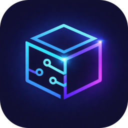
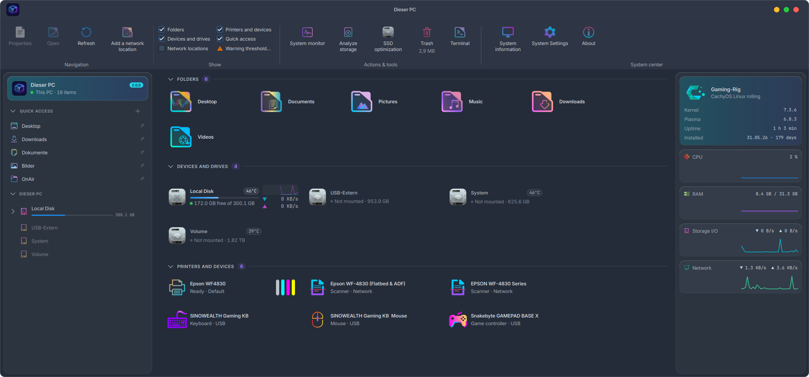
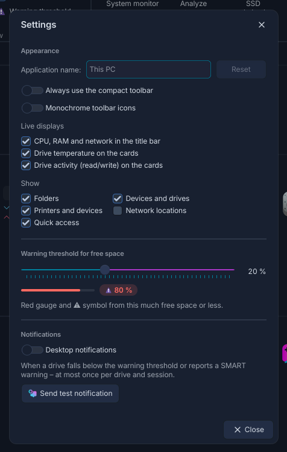
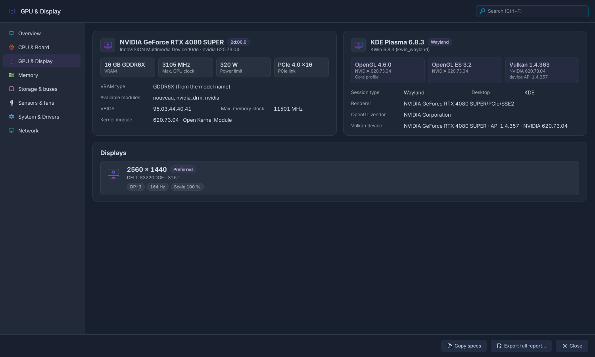
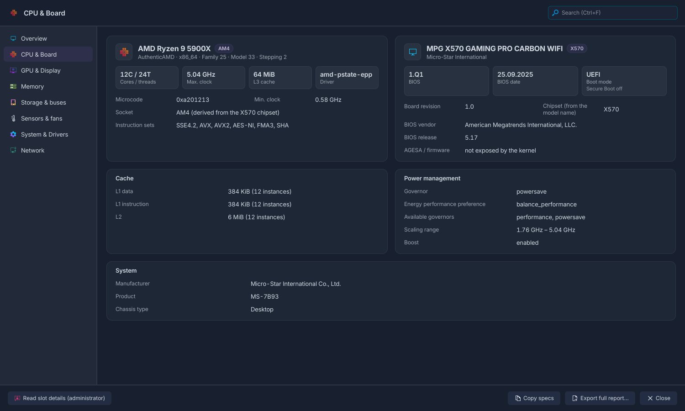

<p align="center"></p>

# DriveDeck

A "This PC" window for **KDE Plasma 6**, inspired by Windows. It shows your personal folders, drives, network
locations, printers and devices in one clean window, and it follows your Plasma colours and icon theme.

> **DriveDeck is a community fork** of **Fenestra "This PC"** by [naykkalak](https://github.com/naykkalak/fenestra-ce-pc).
> All credit for the original idea, design and code goes to **naykkalak**. This fork fixes bugs, makes the program
> faster and adds many new features under its own name. See [what is different](#whats-different-in-this-fork) below, or
> the detailed [CHANGELOG](CHANGELOG.md).

<p align="center"></p>

**Version 2.5.0** – feedback and bug reports are very welcome.

---

## What the program does

Open it and you see everything about your computer in one place:

- **Folders** – Desktop, Documents, Pictures, Music, Downloads, Videos. A double click opens them in Dolphin (one click if your desktop is set to single-click).
- **Drives** – internal disks, USB sticks, memory cards and CD/DVD drives, each with a bar that shows how full
  they are. You can eject USB sticks safely, rename them and check the disk health.
- **Network locations** – add a shared folder from another computer or NAS (SMB) without a terminal. Passwords are
  stored safely in KWallet.
- **Printers and devices** – printers with their status and ink levels, plus keyboards, mice, game controllers and
  similar devices.

The window remembers its size, supports 13 languages and uses your own system colours and icons. Drives also show a
small **live graph** of their read and write speed, and warn you when they are almost full.

---

## What's different in this fork

### Problems that are fixed

| What went wrong before | What happens now |
|---|---|
| On computers with a **Btrfs** disk, double-clicking your main drive ("Local Disk") opened a strange system folder (`/var/tmp`). | It opens **your home folder**, for every user. The main drive is also recognised correctly again (sort order, icon, health check). |
| The list of drives **flickered** and an open right-click menu **closed by itself** every few seconds, because the free space changes all the time. | The list only redraws when something you can actually see has changed. |
| Network folders with a **space in their name** (for example `My Share`) showed up twice. | They show up once. |
| Version comparison fixed: 1.1.0 was wrongly treated as newer than 1.1, which could trigger a false update notice. | Fixed. |
| A USB stick could be **mistaken for the previous stick** after you swapped them. | Every refresh now checks the real device. |
| A drive that simply had no name could end up with the wrong name, or a drive really named "Local Disk" got renamed. | Unnamed drives get a clear fallback name ("Local Disk" or "Removable Disk"), and real names are left alone. |
| Two parts of the program could **write to the same settings file at the same moment** and corrupt it. | They now take turns. |
| User names containing a `%` sign could break the network login. | They are now rejected with a clear message. |
| Opening folders left **invisible leftover processes** running in the background until the program was closed. | They are cleaned up automatically. |
| If the scanner tool was not installed, the program kept **searching for scanners** for nothing. | It stops when the tool is missing. |

### A calmer look (2.0.0)

- **Finder-style sidebar** (248 px): full-height column set apart by a soft glass divider, 34 px rows with 18 px icons and
  13 px text, quiet
  section headings, a slim capacity line and the size for each drive, eject on hover; unmounted drives have a dimmed icon
  and a secondary (still readable) label.
- **Cards float freely** and only show a neutral surface on hover and an accent-tinted one when selected, like the
  sidebar; slim 4 px usage bars, a green or grey mount dot, and ink level bars on printer cards.
- **Apple HIG polish:** one palette of Apple system colours for every status, secondary text that meets WCAG AA
  (4.5 : 1) in light and dark themes, a 4 px spacing grid, four corner radii, 150 ms fades for every state and a
  macOS-style focus ring outside buttons.
- **Typography:** Inter for the interface and JetBrains Mono with tabular figures for live values, when installed
  (see *Optional tools* below). On Arch/CachyOS: `sudo pacman -S inter-font ttf-jetbrains-mono`; on Debian/Ubuntu:
  `sudo apt install fonts-inter fonts-jetbrains-mono`. Without them DriveDeck uses your system font.
- **Inspector** on the right (from 1280 px width, 300 px): a calm column without cards, sections divided by hairlines and
  key/value pairs in the Finder "Get Info" grid. A system overview with live CPU, RAM, storage I/O and network graphs when
  nothing is selected, or details, SMART health and quick actions for the selected folder, drive, network location,
  printer or device.
- **Screen readers:** cards, chips, sidebar rows, inspector details and buttons have localized names that Orca can read.
- **Keyboard:** Tab goes main area → sidebar → ribbon (buttons and *Show* boxes) → settings → inspector toggle → window
  buttons → main area (Shift+Tab backwards, Esc back to the main area); `Ctrl+,` opens the settings, `Ctrl+I` shows or
  hides the inspector.
- Works with light and dark Plasma colour schemes.

### New in 2.5.0

- **System information at a glance.** The hardware window leads every main card with the product name, a badge
  (socket, chipset, PCI slot, session) and 2–4 tiles with the key figures, then the details in two columns. Graphics
  APIs appear as version tiles (OpenGL, OpenGL ES, Vulkan), every screen as a tile with resolution, refresh rate, scaling
  and its name from the EDID, and sensor cards show small readings as tiles with their session minimum and maximum.
  Long technical strings are shortened on screen; the full text stays in the tooltip, when copying and in the report.
- **Sensors & fans and Network.** Temperatures and fan speeds with min/max, a read-only fan control line (BIOS or
  fancontrol), and the data usage of today, this week and this month from vnstat or DriveDeck's own counter.
- **More settings** (thanks to Sadi58, [#4](https://github.com/elbecode-dev/DriveDeck/issues/4)): monochrome toolbar
  icons, and the title-bar monitor, drive temperature and drive activity can each be switched off. The "…" button of the
  compact toolbar is gone; the gear, `Ctrl+,` and a right-click on the toolbar open the settings.
- **Optional extras in the installer:** vnstat and lm_sensors, only in a terminal and only when you answer *y*.

<p align="center"></p>

### New in 2.3.0

- **Settings in one place.** A gear next to the inspector toggle, "…" in the compact toolbar or `Ctrl+,` open one
  small dialog with the application name, the toolbar choice, the visible sections, the warning threshold (with a live
  preview) and notifications.
- **Desktop notifications (optional).** Once per drive and session when a drive falls below the warning threshold or
  reports a SMART warning.
- **Network fixes.** Shares mounted by IP address are recognised under their saved host name, shares that normal users
  may not unmount can be disconnected as administrator after one question, and removing a location really deletes its
  password from KWallet.

### New in 2.2.1

- **Every language is complete again.** The texts added by this fork are now translated into all 13 languages, not
  only German; long toolbar labels in French, Dutch or Russian are no longer cut off.
- **Clearer installer.** When PyQt6 is installed but cannot be loaded, `install.sh` explains why and how to fix it
  (thanks to 3Shadow3S, [#3](https://github.com/elbecode-dev/DriveDeck/issues/3)).

### New in 2.2.0

- **Finder-style side columns.** Sidebar and inspector are full-height columns set apart by one hairline instead of
  floating glass panels with cards; the inspector shows details in the Finder "Get Info" grid.
- **Apple HIG design pass.** Every text meets WCAG AA (4.5 : 1) in light and dark themes, all statuses use one palette of
  Apple system colours, hover and selection look the same everywhere, keyboard focus is a ring outside the element, and
  spacing, radii and animations follow one system. The neon glow, outlines and accent stripes are gone.
- **Calmer ink bars.** Printers that report pure RGB colours are shown in muted print tones.

### New in 2.1.0

- **Compact toolbar.** When the four ribbon groups do not fit between the side panels (about 2175 px window width with
  both panels in German), the ribbon becomes a centred 48 px toolbar with the same commands as icons,
  tooltips and screen-reader names. "…" opens the settings (sections, warning threshold, "Always use the compact
  toolbar"); right-clicking the toolbar also offers that switch. Wide windows keep the full ribbon.
- **SMART health without a password.** For internal NVMe and SATA drives DriveDeck reads the key SMART values through
  udisks2: wear, spare capacity, power-on time, power cycles, unsafe shutdowns, data written and read, media errors or
  reallocated/pending sectors, temperature and the last self-test, with an overall "Good / Warning / Critical". They appear
  in a collapsible *SMART health* section of the inspector and in the Properties window. Drives in a USB enclosure still
  use the full `smartctl` report with the existing bridge fallbacks (administrator password).
- **One card per scanner.** A network scanner seen by several drivers (eSCL, airscan, epson2 …) is merged by IP address
  or model name; the more descriptive entry ("Epson WF-4830 (Flatbed & ADF)") wins.
- **Wi-Fi printers no longer flicker.** A printer turns grey only after three failed checks in a row; during a short
  drop-out its last ink levels stay on the card.
- **Live click setting.** Changing "single click / double click" in System Settings applies to DriveDeck at once.
- **Ink names and warning.** Cartridge names are recognised by part of the name ("Photo Black ink" → "Photo black",
  "Black Toner Cartridge" → "Black (toner)") and translated. A cartridge is low at the printer's own threshold, or at 10 %
  if the printer declares none.

### It is much faster and smoother

- **The window opens instantly.** Slow checks (disks, disk health, network, printers) now run **in the background**
  instead of making the window wait for them.
- **Your drives show up immediately** when you start the program, because the last known list is remembered.
- **One slow device no longer slows down everything.** A switched-off NAS used to delay the printer list. Disks,
  network locations and printers are now handled separately, and many devices are checked **at the same time**
  instead of one after another.
- **Much less work in the background.** The program used to run several system tools every 3 seconds. Now it only
  takes a tiny look at the system every second and does the full check **when something really changes** (you plug in
  a stick, mount a drive, …). Free-space bars are refreshed every 10 seconds.
- **Fewer system calls.** Information that used to need one request per disk is now collected in a single request.

### New features

- **Unmounted drives are now visible.** A second hard disk, a Windows partition or a USB stick that was not opened
  automatically shows up as a card marked "Not mounted". **Double-click it** (or right-click → *Mount*) and it is
  connected and opened. Tiny system partitions (boot, recovery, swap, encrypted) are hidden on purpose.
- **More right-click options**
  - On drives: *Mount*, *Unmount*, *Open in terminal*, *Analyze storage*, *Copy path* (folder cards and the Quick access pane
    also offer *Analyze storage*)
  - On network locations: *Disconnect*, *Open in terminal*, *Copy path*
  - On printers: *Properties*, *Set as default printer*, *Print test page* (the real CUPS test page), *Open settings*, *Copy name*.
    On scanners: *Scan…* (Skanpage, also as a Flatpak, otherwise simple-scan, kooka or xsane) and *Copy name*. On keyboards,
    mice and game controllers: *Open settings* and *Copy name*
- **A ribbon in four groups, read from left to right.**
  - *Navigation*: Properties, Open, Refresh and Add a network location.
  - *Show*: tick which sections you see, and **Warning threshold…** (see below).
  - *Actions & tools*: **System monitor** (Plasma System Monitor, otherwise btop or htop), **Analyze storage** (Filelight,
    otherwise Baobab or ncdu), **SSD optimization** (runs `fstrim` on all mounted drives after asking, and Plasma asks for
    your password), **Trash** (opens it and shows its size) and **Terminal**.
  - *System centre*, stretching to the right edge: **System information**, **System Settings** and **About**, then a card with the **logo of
    your distribution** (read from `os-release`, so it works for CachyOS, Arch, Ubuntu, Fedora … alike), the **uptime**, the
    approximate **installation date**, computer name with distribution and version (shown in full) and **kernel and Plasma
    version**, and at the far right the **system summary**: four live chips in one tinted panel (**CPU** load, **RAM** used /
    total, **Storage** of all mounted local drives together and **Network** throughput ▲ sent, ▼ received; thin
    purple-to-cyan bars that turn amber at 80 % and red at 90 %).
  - What does not fit is left out in a fixed order: first the distribution card (below about 1990 px window width), then
    the summary panel (below about 1710 px). If the window is narrower than the buttons need, the full ribbon gives way to a
    48 px **compact toolbar** (see below). The ribbon grows with a larger system font.
- **Single or double click – as your desktop says.** Folders, drives, network locations and devices open with a
  **double click** by default, and with one click if your desktop explicitly uses single-click (KDE: *System Settings →
  Workspace Behavior → General Behavior*). You can also force it in `~/.config/drivedeck/settings.json` with
  `"click_mode": "double"` or `"single"`. *(Idea by Sadi58.)*
- **Adjustable "almost full" warning.** In the ribbon group *Show*, **Warning threshold…** opens the settings at a
  slider (1 to 50 % free space, default 20 %) with a live preview of the red bar and the warning badge. The bars and ⚠
  badges change at once and the value is remembered. *(Idea by Sadi58.)*
- **Settings in one place.** The gear next to the inspector toggle, `Ctrl+,` or a right-click on the toolbar open one
  small dialog with everything that used to be spread over the ribbon, the "…" menu and the *About* window: the
  application name, "Always use the compact toolbar", monochrome (symbolic) toolbar icons, which sections are shown,
  the live displays (CPU, RAM and network in the title bar, drive temperature and drive activity on the cards – each can
  be switched off), the warning threshold and desktop notifications. `Esc` closes it; every control is reachable with
  Tab and has a screen-reader name.
- **Desktop notifications (optional).** When switched on in the settings, DriveDeck notifies you once per drive and
  session when a drive or mounted share falls below the warning threshold, or when a drive reports a SMART warning or
  failure (`notify-send`, or the desktop notification service over D-Bus). *Send test notification* checks that they
  arrive. They are off by default.
- **Unmount.** *Unmount* in a drive's right-click menu only logs the drive out and leaves it powered on, unlike
  *Safely remove*. It is not offered for system folders (`/`, `/boot`, `/home` …) or optical drives.
- **System information (HWiNFO-style).** The *System information* button opens a separate, freely resizable window
  (at least 820 × 580, remembers its size and whether it was maximized) with these categories: *Overview*, *CPU &
  Board* (model, family/model/stepping, microcode, caches, governor, socket, board, chipset, BIOS), *GPU & Display* (VRAM,
  driver and version, PCIe link, Wayland/X11, KWin, OpenGL, Vulkan), *Memory*, *Storage & buses* (NVMe/SATA controllers
  with their PCIe link, SATA links, USB host controllers and every USB device with its negotiated speed – 12 Mb/s,
  480 Mb/s, 5/10/20 Gb/s), *Sensors & fans* (all temperatures and fan speeds from `/sys/class/hwmon` plus NVIDIA via
  `nvidia-smi`, updated every 2 seconds with the minimum and maximum of the session; the mainboard card shows temperatures
  and fans side by side and whether the BIOS or `fancontrol` controls the fans – read-only, DriveDeck never changes fan
  speeds), *System & Drivers* and *Network*
  (the active connection with link speed, IPv4/IPv6 addresses, gateway, DNS servers and MAC address next to its adapter,
  and the **data usage** right now, this session, today, this week and this month – from `vnstat` once its database covers the
  period, otherwise from DriveDeck's own counter in `~/.local/share/drivedeck/net_usage.json`, which notices reboots through the
  kernel's boot ID). From 900 px of content width (the default window size) the cards sit side by side in pairs of equal height; lists and tables
  span the full width. `Ctrl+F` searches all categories at once and shows the
  number of hits next to each category; a click on any row (or Enter on the row chosen with the arrow keys) copies it.
  `Esc` clears the search, then closes the window. The CPU socket is derived from the chipset or the CPU family without
  root (for example "AM4 (derived from the X570 chipset)"); exact RAM slot details still need *Read slot details
  (administrator)*, which runs `dmidecode` through `pkexec`. *Copy specs* copies a short summary for a forum post;
  *Export full report…* saves everything as text or JSON, always with English labels.

<p align="center"></p>
<p align="center"></p>

- **Disk health that works with USB drives.** Many USB enclosures need a special mode before they report SMART data.
  DriveDeck tries the usual ones for you (SAT, then several NVMe bridge types), asks for your password **only once**
  when root rights are needed, and explains clearly when an enclosure simply does not pass SMART through.
- **Use it with the keyboard.** The arrow keys move through **everything**: folders, drives, network locations,
  printers and devices, and the sidebar. **Left** in the first column jumps into the sidebar, **Right** on a pinned folder (or
  **Tab**) comes back. In the sidebar **Right** unfolds a folder and then goes to its first sub-folder, **Left** folds it
  again or jumps to the parent folder. **Enter** opens, **Space** unfolds, **Home**/**End** jump to the first/last entry,
  **F5** refreshes, **Esc** clears the selection and **Ctrl+C** copies the path.
- **Only one window at a time.** Starting the program a second time simply brings the existing window to the front.
- **Correct name and icon in the task bar.** On Wayland the window now shows its real icon and name instead of
  "python3".
- **Live read/write graph per drive.** Every drive card shows a small graph of the last minute: green is reading,
  yellow is writing. Next to it the current read (▼) and write (▲) speed is shown as numbers, e.g. `450 KB/s` or
  `12.4 MB/s`. (Needs NumPy; without it graph and numbers are simply not shown.)
- **"Almost full" warning.** When less than 20 % is free (adjustable, see above), the bar and the ring turn red and the card
  gets a badge such as "⚠ 90 %".
- **Disk temperature.** Each drive card shows its current temperature in a small chip (it turns amber and red when
  the disk gets too warm). It is read from the system's sensors, so it works for NVMe drives out of the box. For SATA
  drives load the kernel module once with `sudo modprobe drivetemp`. USB enclosures usually pass the temperature on only
  through `smartctl`, and that needs **administrator rights** (the SMART dialog asks for them once). DriveDeck never asks
  for a password in the background, so such cards show no chip unless `smartctl` may run without root on your system
  (an advanced setup, see the smartmontools documentation). If it can, the chip appears automatically.
- **Straight to the right settings.** On the cards under *Printers and devices*, **double-click** (or one click, see *Single or double click*; or right-click →
  *Open settings*) a game controller, keyboard, mouse, touchpad or drawing tablet and the matching System Settings page
  opens right away. Printers still open their properties on double-click.
- **Ink levels at a glance.** A printer card now shows a small bar for each ink cartridge in its own colour, so you no
  longer need *Properties* to see how much is left. Hover it for the exact percentages.
- **Quick access – pin your favourite folders.** A pane on the left (inspired by the Windows Explorer) keeps the
  folders you use most. Right-click any folder or drive card and choose *Pin to Quick access*, press **+**, or just
  drag a folder from Dolphin onto the pane. Click opens it, the little pin removes it again, right-click lets you
  reorder. Below it, **This PC** shows your drives as a tree: click a drive or folder to unfold it, double-click to open it
  in Dolphin, and pin any folder you find. You can hide the pane with the *Quick access* check box in the *Show* group.
- **For tinkerers:** the user interface can be exported to a file and loaded from there, which makes it easy to edit
  with syntax colours (see [Developer notes](#developer-notes)).

### A fresher look

- The pie chart in the *Properties* window is now a smooth **donut ring** with the percentage in the middle.
- Usage bars are slimmer and rounded, and **animate** to their value.
- Cards react more softly to the mouse: they fade a highlight in, the icon grows a little, and the selected card gets
  an accent strip. Folders, drives, network locations and printers all share **one hover look**: a translucent
  purple-to-cyan gradient with a glowing gradient border.
- Text is easier to read: labels and subtitles use larger sizes relative to your system font, and secondary text has more
  contrast.
- Section headers ("FOLDERS", "DEVICES AND DRIVES", …) are in capitals with the item count as a small pill and a line that
  fades out to the right. Divider lines are softer.

### Small things

- The built-in update check is **switched off** in this fork, because it would point to the original project and
  suggest replacing this version. (You can switch it back on with your own repository, see the code comment at
  `MAJ_API`.)
- **All 13 languages are complete again:** the texts added by this fork are translated into German, Spanish, French,
  Italian, Japanese, Dutch, Polish, Brazilian Portuguese, Russian, Turkish and Simplified and Traditional Chinese.
  Apart from German they were translated with AI help and not yet reviewed by native speakers – corrections to the
  files in `locale/` are very welcome.
- Programs started from DriveDeck (Terminal, System monitor, Dolphin, …) run completely on their own and no longer
  hang under DriveDeck in the process tree.
- The program gives unused memory back to the system after heavy work (opening the System information window, minimising).
- Unused leftover code was removed.

---

## Requirements

- **KDE Plasma 6** (Wayland, same as the original)
- **Python 3** with **PyQt6** (QtQml, QtQuick) and **Kirigami** and `qqc2-desktop-style`
- `lsblk` and `udevadm` (almost every Linux system has them)

Optional tools switch on extra features:

| Tool | Feature |
|---|---|
| `smartctl` / udisks2 | Disk health |
| `smbclient` | Finding and adding network shares |
| `udisksctl` | Mounting, unmounting and safely removing drives |
| `lpstat`, `ipptool`, `avahi-browse` | Printer status and ink levels |
| `konsole` | "Open in terminal", Terminal button |
| `plasma-systemmonitor` / `btop` / `htop` | System monitor button |
| `filelight` / `baobab` / `ncdu` | "Analyze storage" |
| `lspci`, `lscpu`, `nvidia-smi`, `glxinfo`, `vulkaninfo`, `pactl` | Details in *System information* |
| `dmidecode` + `pkexec` | RAM slots and CPU socket in *System information* |
| NumPy (`python-numpy`) | Live read/write graph on the drive cards |
| `inter-font` + `ttf-jetbrains-mono` (Arch/CachyOS), `fonts-inter` + `fonts-jetbrains-mono` (Debian/Ubuntu) | Optimal typography: Inter for the interface, JetBrains Mono for live values (both under the SIL Open Font License; nothing is bundled, without them the system font is used) |

---

## Install

The program installs for your user only. The installer checks every requirement above and, on Arch/CachyOS, Fedora and
Debian/Ubuntu, offers to install the missing packages for you (it asks for your `sudo` password once, and only if you
agree). It can also switch on the CUPS and Avahi services so that printers show up.

```bash
git clone https://github.com/elbecode-dev/DriveDeck.git
cd drivedeck
bash install.sh
```

Options: `--yes` installs missing packages without asking, `--no-deps` skips package installation (and the extras below),
`--no-desktop-icon` skips the desktop shortcut, `--no-extras` skips the optional extras. Package names were checked on
Arch/CachyOS; on Fedora and Debian/Ubuntu a wrong name only means that one package is skipped.

**Optional extras.** At the end, and only when you run the installer in a terminal, it offers two extras. Both default
to *no*: pressing Enter skips them, and DriveDeck works fully without them.

- **vnstat** keeps network statistics across reboots; DriveDeck then takes today, this week and this month from it.
  On *y* the installer installs it (pacman, dnf, apt or zypper), runs `sudo systemctl enable --now vnstat` and
  registers the interface of the default route (`sudo vnstat --add -i <interface>`).
- **lm_sensors** finds the sensor chips of many mainboards and memory modules. On *y* the installer installs it and
  runs `sudo sensors-detect --auto`; new drivers are loaded at the next restart at the latest.
- **fancontrol** is never set up automatically. For your own fan curve, run `sudo pwmconfig` once and then
  `sudo systemctl enable --now fancontrol`; DriveDeck then shows "fancontrol active" (it only reads the fan state).

The program then appears as **DriveDeck** in your application menu (and on the desktop unless you use
`bash install.sh --no-desktop-icon`).

To remove it again: `bash uninstall.sh` (keeps your settings) or `bash uninstall.sh --purge` (removes everything).

**Updating:** pull the latest version and run `bash install.sh` again.

**If the installer says PyQt6 is missing although it is installed,** it now explains the cause: usually a `python3`
that is not the system Python (conda, pyenv, venv) or PyQt6 files from another source that Python cannot load. Reinstall
PyQt6 from your distribution (for example `sudo apt install --reinstall python3-pyqt6 python3-pyqt6.qtquick`).

---

## Known limitations

- Drive temperature of USB enclosures needs administrator rights (see *Disk temperature* above), so those cards show no
  temperature chip. *Read SMART…* in the inspector (one password prompt) shows their temperature and SMART values.
- Tested on KDE Plasma 6 (CachyOS) with a Btrfs system disk and an NVIDIA GPU. Other setups should work, but have not been
  tested by the fork maintainer. This includes AMD/Intel graphics and Wi-Fi details in the *System information* window, the
  administrator prompt for the RAM slot details, and the package installation on Fedora. A Debian-based installation has
  been reported to work once PyQt6 loaded correctly ([#3](https://github.com/elbecode-dev/DriveDeck/issues/3)).
- There is no automated test suite in the repository. Changes are checked with `pyright`, `qmllint`, scripted offscreen
  runs of the window (layout, contrast, keyboard, a 60-second stress run) and by hand on KDE Plasma; see
  [audits.md](audits.md).

---

## Developer notes

```bash
# Run directly from the source folder
python3 drivedeck.py

# Export the user interface (QML) to a file, edit it, and run from the file
python3 drivedeck.py --dump-qml > drivedeck.qml
DRIVEDECK_QML=drivedeck.qml python3 drivedeck.py

# Allow several windows at once (for testing)
DRIVEDECK_MULTI=1 python3 drivedeck.py
```

Bug reports and pull requests are welcome. If you find a problem, please include the terminal output of
`python3 drivedeck.py`.

Quality audits (stress, performance, code and UI) and what they found are summarised in [audits.md](audits.md).

---

## Credits and licence

- Original project: **naykkalak** – [fenestra-ce-pc](https://github.com/naykkalak/fenestra-ce-pc)
- Icon sets and design ideas as credited in the original project (Fluent UI System Icons by Microsoft, MIT licence;
  Windows Modern for KDE Plasma 6 by Jeysef; Win11OS-kde by yeyushengfan258). These are **not** bundled with the
  program unless the original project bundles them.
- DriveDeck (fork changes, new features, name and icon): Christian, 2026
- Thanks to **3Shadow3S** for the PyQt6 file-name diagnosis behind the installer hint ([#3](https://github.com/elbecode-dev/DriveDeck/issues/3)).
- Thanks to **Sadi58** for the settings ideas in 2.5.0 – monochrome toolbar icons and switchable live displays ([#4](https://github.com/elbecode-dev/DriveDeck/issues/4)) – and earlier for the click mode and the warning threshold.

## AI assistance

The changes in this fork were developed by Christian with the help of AI assistants
(Claude by Anthropic and Gemini by Google). The code was reviewed and tested by hand on
KDE Plasma 6, but as with any software, bugs are possible. Bug reports are welcome.

Licensed under the **GNU General Public Licence v3.0 or later** (see `COPYING`), the same as the original.
This project is **not affiliated with Microsoft** or with the original author.
